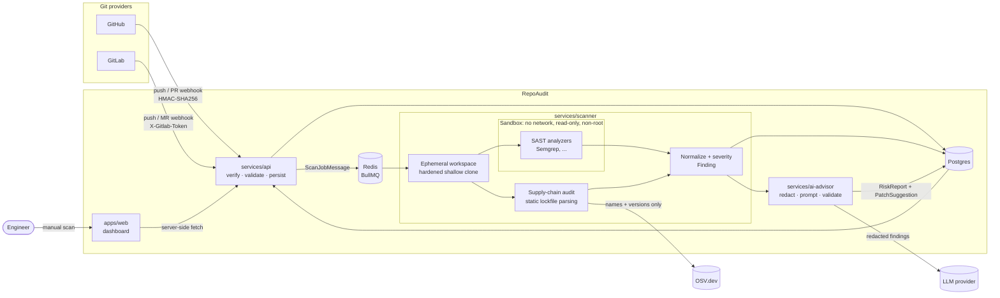
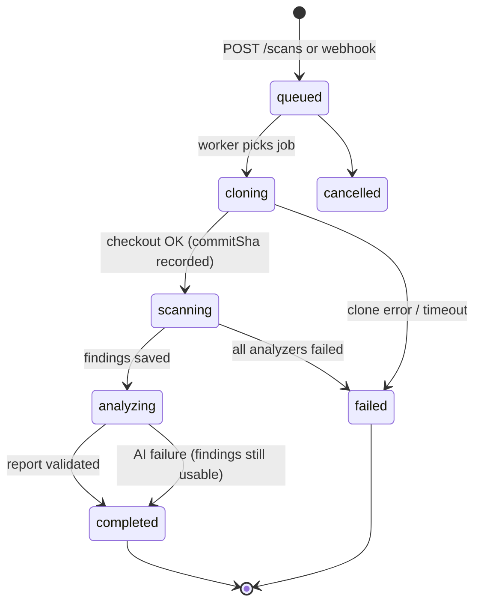
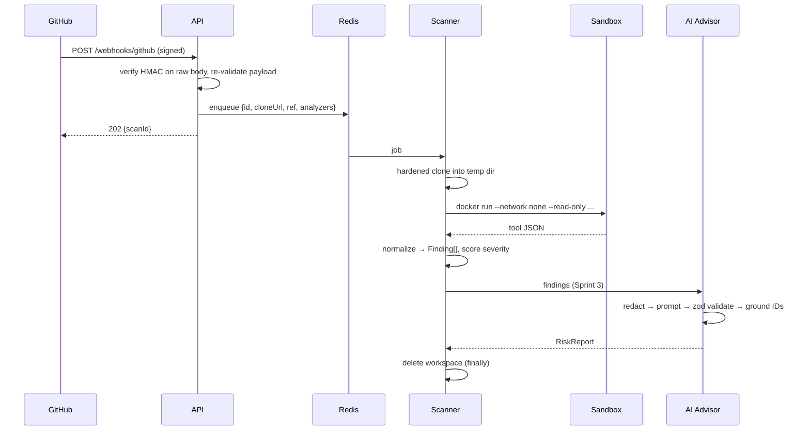

# RepoAudit Architecture

## 1. Goals and non-goals

**Goals**
- Audit GitHub and GitLab repositories on push, merge request or manual trigger.
- Detect code vulnerabilities (SAST) and supply-chain risk (CVEs, outdated or suspicious packages).
- Produce a prioritized, human-readable risk report with reviewable patch suggestions.
- Stay safe while processing hostile repositories.

**Non-goals (v1)**
- Dynamic analysis / running the target application.
- Automatically committing or merging fixes.
- Building our own vulnerability database. We consume authoritative sources such as OSV.dev.

## 2. Components

| Component | Tech | Responsibility | Owner |
|---|---|---|---|
| `apps/web` | Next.js 16 (App Router, Server Components), React 19, Tailwind 4 | Dashboard: overview, repositories, findings, AI remediation review | Lead |
| `services/api` | Fastify 5, zod, BullMQ producer | Webhook ingestion + verification, scan job CRUD, enqueueing | Lead (webhooks) / Sec-Backend (queue, persistence) |
| `services/scanner` | Node worker, BullMQ consumer, Docker sandbox | Ephemeral workspace, analyzers, normalization, severity scoring | Sec-Backend |
| `services/ai-advisor` | Fastify, pluggable LLM providers | Risk report synthesis, patch proposals, output validation | Lead |
| `packages/shared-types` | zod | Contracts: `Repository`, `ScanJob`, `Finding`, `Severity`, `RiskReport`, `PatchSuggestion` | Both |
| Postgres | 17 | Repositories, scans, findings, reports, patch decisions | Sec-Backend |
| Redis | 7 | Job queue (BullMQ) | Sec-Backend |

## 3. End-to-end data flow

### Scan lifecycle

> In the current skeleton the scanner goes straight from `scanning` to `completed`. The `analyzing` stage is wired in Sprint 3.

### Sequence: webhook to report

## 4. Key design decisions

| Decision | Rationale |
|---|---|
| **TypeScript everywhere, zod as the contract** | One language for a 2-person team. Runtime validation at every trust boundary (HTTP, queue, LLM output) from the same schemas as the types. |
| **shared-types consumed from source** (`workspace:*`, Next `transpilePackages`) | No build step or publish loop during the 3-month project. |
| **Ports & adapters** (`ScanRepository`, `JobQueue`, `SandboxRunner`, `Analyzer`, `AdvisorySource`, `LLMProvider`, `ResultSink`) | Each external dependency is swappable and testable. In-memory or mock adapters keep local dev offline. |
| **Queue between API and scanner** | Scans are slow and risky. The API stays responsive, and workers scale and crash independently. `jobId = scanId` makes webhook redeliveries idempotent. |
| **Analyzers in Docker with `--network none`** | Analysis needs no network, so data exfiltration and SSRF are cut off by construction. Rule packs are vendored. |
| **Advisory lookups from the worker, not the sandbox** | Only `(ecosystem, name, version)` leaves the host, never source code. |
| **Server Components fetch the API** | The browser never talks to the API directly: no CORS surface and no tokens in the client bundle. |
| **LLM output treated as untrusted** | Schema validation, finding-ID grounding and human approval come before any patch is used. |

## 5. Extending

- **New analyzer:** implement `Analyzer` (`services/scanner/src/core/analyzer.ts`), map its output to `Finding`, and register it in `src/index.ts`.
- **New advisory source:** implement `AdvisorySource` (for example, the GitHub Advisory DB).
- **New LLM provider:** implement `LLMProvider` and add it to `providers/index.ts` and the `AI_PROVIDER` enum.
- **New sandbox backend:** implement `SandboxRunner` (gVisor `runsc`, Firecracker, Kubernetes Jobs).

## 6. Known gaps in the skeleton

| Gap | Planned |
|---|---|
| In-memory scan repository in the API. The scanner reports to the console, so API status stays `queued`. | Sprint 1: Postgres adapters |
| No automated tests yet; Semgrep and the Docker sandbox path have not been exercised | Sprint 1 harness, Sprint 2 rules |
| No auth on dashboard or API | Sprint 1 design, Sprint 4 enforced before beta |
| Semgrep skipped until rules are vendored | Sprint 2 |
| OSV matches lack CVSS and fixed versions | Sprint 2 |
| Typosquat detector has no popular-package list | Sprint 2 |
| AI advisor not yet invoked by the pipeline | Sprint 3 |
